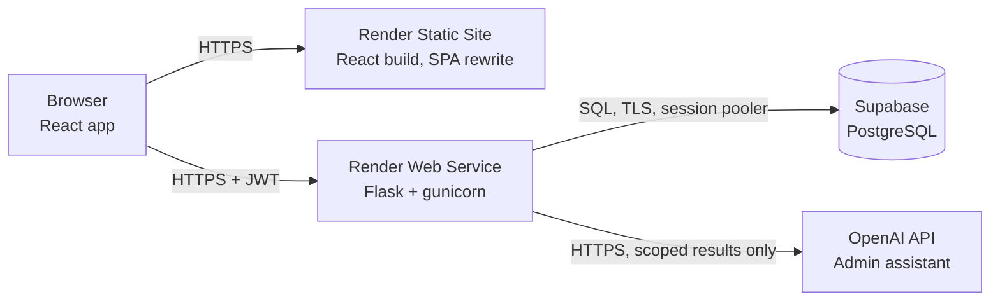
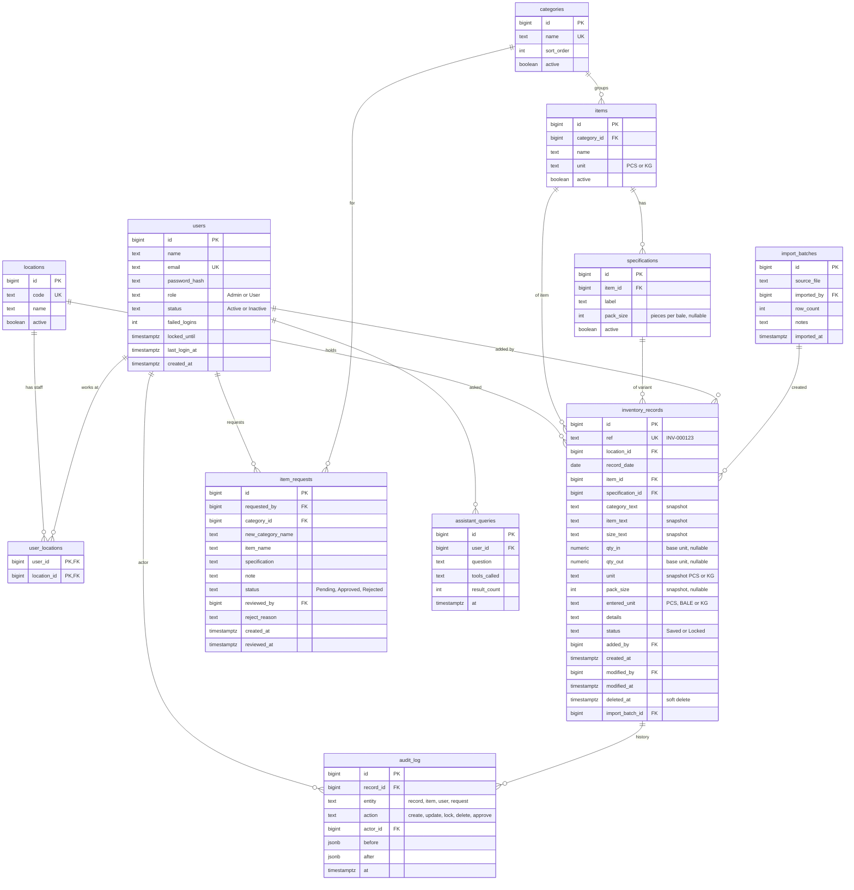

# Backend Architecture and Data Model

**Gosrani Wholesalers Limited, Eldoret, Kenya: Inventory Management System**

Status: design proposal, ready for review. Items marked **DECISION** need confirmation before the backend build starts.

---

## 1. Inputs and decisions already made

| Topic | Decision |
| --- | --- |
| Users | 20 to 50 accounts, about 10 concurrent at peak |
| Volume | 200 to 500 entries per day |
| Locations | One location now (the Eldoret godown). The design must scale to 5 locations without rework |
| Hosting | Render (static frontend and Flask API), Supabase (PostgreSQL database) |
| Connectivity | Always online. No offline entry |
| Stock rules | Warn only when stock would go negative. No backdating limit |
| Existing data | `GW Godown Stocks` Google Sheet (analysed in section 2) |
| Stack | React (frontend), Flask and Python 3.12 (backend), Pipenv, PostgreSQL |
| Roles | **Admin**: everything. **User**: Inventory list and Add Entry only. The assistant, catalog, user management, and record detail pages are Admin-only |

---

## 2. What the existing sheet tells us

The sheet is a **matrix**: one row per product, and for every date a pair of columns (IN, OUT). Later columns also show a calculated STOCK figure. It runs from 20/7/26 to 4/11/26 and is grouped into sections: Duvet, Pillow, Mattress, Cushion, Sofa Sets, Blankets, Bedcovers, Pillow cases, and Fibre.

### 2.1 It confirms the core model

Each filled IN or OUT cell is one movement of one product on one date. That maps directly onto the seven-field record (Date, Category, Item, Size/Specification, Quantity In, Quantity Out, Details). The sheet's sections are our **categories**. Stock is always **sum(IN) minus sum(OUT)**, so it is calculated, never typed.

### 2.2 Findings that change the design

| # | Finding in the sheet | Design consequence |
| --- | --- | --- |
| 1 | A **Packing** column gives pieces per bale (5, 10, 20, 50, 100). Quantities are mostly counted in **bales (Bls)**, some in **pieces (Pcs)**. | Each specification stores its `pack_size`. Each item has a counting unit. |
| 2 | Many cells are **mixed**: `98 +18PCS`, `140+1 PC`, `32+7 PCS`, `493+7PCS` (bales plus loose pieces). | Quantity entry must support bales plus pieces. Stock is stored in one base unit (see 4.2). |
| 3 | Some cells carry **notes**: `4(MILK)`. | Goes into the record's Details field. |
| 4 | The sheet's total row (for example 1650) **adds bales and pieces together**: 80 + 190 + 0 + 50 + 30 bales of duvets plus 1300 duvet bags. | The system never sums across different units. Stock is shown per product only. |
| 5 | **Fibre** is noted in kilograms (`87 bales 22,816kgs`). | Fibre is tracked in kg, so quantities must allow decimals. |
| 6 | **Date columns are not in order** (25/7, then 8/8, then 28/7). One date is mistyped (`29/926`). | Import sorts by date and corrects typos. The database stores real dates. |
| 7 | The first column (20/7/26) holds large INs such as 689 and 262, which look like **opening stock**. | Opening balances are entered as normal IN records with a Details note. |
| 8 | Green-highlighted stock cells and daily STOCK columns exist. | STOCK is derived data. It is **not** imported, only used to check the import. |
| 9 | Mattress sizes are encoded in the name (HDF 36*4, SHDF 72*10, SHDQ 60*8). | Split into Item (HDF, SHDF, SHDQ) and Size/Specification (36x4, 72x10). |
| 10 | Your list of offloaded goods includes **packaging materials** (pillow bags, polythene bags) that are not in the sheet. | Add categories for them (see 3). |

### 2.3 Name differences to confirm

| Your list | The sheet | DECISION |
| --- | --- | --- |
| Woolen Blanket 5x6 | Woolen Duvet 5*6 | Same product? Which name is correct? |
| Vivo Mattresses | HDF, SHDF, SHDQ mattresses | Is "Vivo" a brand? Does it apply to all of them? |
| 4" SHDQ Cushions | CUSHION Q | Same product? |
| 54x80 2T GS Blankets | Bf Goldstar 54x80 2ST | Same product? |
| Pillow Covers | Pillow kiss case, White pillow case | Same products? |

---

## 3. Proposed starting catalog

Categories become the first dropdown, Items the second (searchable), and Specifications the third. Pack sizes come from the sheet.

| Category | Item | Specifications (pack size) | Unit |
| --- | --- | --- | --- |
| Duvets | Duvet N | 4x6 (5), 5x6 (5), 6x6 (5) | Bales / pcs |
| Duvets | Duvet S | 4x6 (20) | Bales / pcs |
| Duvets | Woolen Duvet | 5x6 (20), 4x6 (20) | Bales / pcs |
| Duvets | Duvet Bags | none | Pcs |
| Pillows | Pillow | 600g (10), 1 Kg (10), Light (10) | Bales / pcs |
| Mattresses | HDF | 36x4, 48x4, 48x6 | Pcs |
| Mattresses | SHDF | 48x8, 30x5, 30x6, 42x8, 54x8, 60x8, 72x8, 72x10 | Pcs |
| Mattresses | SHDQ | 60x8, 72x8, 48x8 | Pcs |
| Cushions | SHDQ Cushion | 4" | Pcs |
| Sofa Sets | to be confirmed | | Pcs |
| Blankets | Goldstar Blanket (BF) | 54x80 2ST (20) | Bales / pcs |
| Bedcovers | Bedcover 60x80 | Blue (50), Pink (50), Green (50) | Bales / pcs |
| Pillow Cases | Pillow Kiss Case | none | Pcs |
| Pillow Cases | White Pillow Case | none (100) | Pcs |
| Raw Materials | Fibre | none | **Kg** |
| Packaging | Pillow Individual Packaging Bags | none | Pcs |
| Packaging | Pillow (10 pc) Packaging Polythene Bags | none | Pcs |

**DECISION:** Is packaging stock tracked the same way (IN when offloaded, OUT when used)? Are there other Sofa Set items?

---

## 4. Architecture

### 4.1 Components



- **Frontend:** the React build on a Render Static Site, with a rewrite rule sending every path to `index.html` (the app uses browser-style URLs).
- **API:** one Flask service run by gunicorn. It handles auth, validation, business rules, the audit log, and the assistant. **All rules are enforced here**, never only in the browser.
- **Database:** Supabase is used **only as managed PostgreSQL**. We do not use Supabase Auth, its auto-generated API, or the frontend client library. Flask owns authentication.
- **Assistant:** Flask runs fixed, read-only, location-scoped database queries. When `OPENAI_API_KEY` is configured, it sends the question and at most five matching records to OpenAI to phrase the answer; the model never writes SQL or accesses the database. Without a key, the existing built-in responses are used. Questions and returned inventory details are sent to OpenAI when enabled.

### 4.2 Layers inside the Flask app

```
HTTP route (blueprint)  →  schema/validator  →  service (business rules)  →  repository (SQLAlchemy)  →  PostgreSQL
                                   ↑                      ↑
                          permissions guard         audit writer
```

- **Routes** stay thin: parse the request, call a service, return the `{ data, meta }` envelope.
- **Services** hold the rules: catalog enforcement, locking, review warnings, stock calculation.
- **Repositories** are the only code that touches the database.
- **Permissions** check the user's **current** role, status, and location from the database on every protected request, not just what the token says.

### 4.3 Units and stock (the key modelling choice)

Based on finding 1 and 2, quantities are stored in one **base unit** so stock arithmetic is always exact.

- **Pieces** for goods, **kilograms** for fibre.
- A specification with a `pack_size` (for example 10) lets staff enter **bales or pieces**. The server converts: `98 bales + 18 pcs` at pack size 10 becomes **998 pieces**.
- Each record keeps a **snapshot** of the unit, the pack size, and how it was entered, so history never changes if a pack size is edited later.
- The UI shows stock as `99 bales + 8 pcs` using the snapshot pack size.

**DECISION (D1):** Recommended: this approach. It adds a small **Bales / Pieces toggle** next to the quantity inputs, shown only for baled products. Simpler alternative: store everything as entered in the item's main unit and write loose pieces in Details, but then stock totals cannot include them and will drift.

### 4.4 Multi-location design (one location now, five later)

Every stock-affecting row carries a `location_id` from day one, so adding locations later is data entry, not a redesign.

- `locations` table, seeded with one row (`ELD`, Eldoret Godown).
- `user_locations` links staff to the locations they may use. Admins can use all locations.
- The API resolves the active location from the `X-Location-Id` header, and **defaults to the user's only location**, so the current frontend works unchanged.
- Stock, warnings, filters, and the assistant are always scoped to a location.
- The catalog (categories, items, specifications) is **shared** across locations.
- Later: a location selector in the top bar (hidden while there is one location), and transfers as a linked OUT at one location plus IN at another.

---

## 5. Entity relationship diagram



### 5.1 Key constraints and rules

- **Unique:** `users.email` (lowercase), `categories.name`, one item name per category, one specification label per item, `inventory_records.ref`. Name uniqueness is case-insensitive and whitespace-trimmed.
- **Quantities:** `CHECK (qty_in >= 0 AND qty_out >= 0)` and at least one of the two is present. `NUMERIC(12,3)` so fibre can have decimals. The service rejects decimals for piece-counted items.
- **Catalog changes never rewrite history.** Records keep text snapshots and are never deleted when an item is deactivated. Items are deactivated, not deleted.
- **Soft delete:** deleting a record sets `deleted_at`. All stock queries and lists ignore deleted rows. The audit log keeps the full before and after.
- **`ref` is generated by a database sequence** and never reused.
- **Indexes:** `(location_id, record_date)`, `(location_id, specification_id, record_date)`, and a partial index on `deleted_at IS NULL`.
- **Timestamps** are stored as UTC (`timestamptz`). `record_date` is a plain date, shown as DD/MM/YYYY.
- **Role and status values** are enforced with `CHECK` constraints.

### 5.2 Stock

Stock is calculated, never stored:

```sql
CREATE VIEW v_stock AS
SELECT location_id, item_id, specification_id,
       COALESCE(SUM(qty_in),0) - COALESCE(SUM(qty_out),0) AS stock
FROM inventory_records
WHERE deleted_at IS NULL
GROUP BY location_id, item_id, specification_id;
```

It powers the review warning ("Quantity Out exceeds current stock"), the assistant's stock answers, and the import check. At this volume a plain view is fast enough. Add a nightly snapshot table only if reports slow down.

---

## 6. Business rules enforced by the API

1. **Roles.** User: list records, create records, read the catalog, create item requests, read own requests. Everything else is Admin-only and returns `403` for Users, including record detail, edit, delete, lock, catalog writes, request review, user management, and the assistant.
2. **Locking.** Records saved by a User are `Locked`. Records saved by an Admin are `Saved`. An edit keeps the current status unless an Admin explicitly changes it.
3. **Catalog enforcement.** Reject any record whose category, item, or specification is not in the **active** catalog, or whose item is not in the chosen category. A specification is required whenever the item has any.
4. **Validation.** Date, Category, and Item required. At least one quantity. Quantities non-negative, whole for pieces, decimals allowed for kg.
5. **Review warnings (non-blocking):** quantity at or above a configurable threshold, both quantities filled, Quantity Out above current stock at that location, a future date, and a date more than 180 days old.
6. **All-or-nothing batches.** A multi-row save succeeds completely or saves nothing, in one transaction.
7. **Server-owned fields.** `ref`, `added_by`, `created_at`, `modified_by`, `status`, and `location_id` (from the user's scope) are never accepted from the client.
8. **Last Admin.** The only active Admin cannot be deactivated or demoted.
9. **Audit.** Every create, update, lock, delete, and approval writes a before and after entry.

---

## 7. API map

All responses use `{ data, meta? }`. Errors return `{ message }` with 401, 403, 404, or 422.

| Endpoint | Who | Notes |
| --- | --- | --- |
| `POST /api/auth/login`, `GET /api/auth/me` | Public / signed in | Generic error message. Throttling after repeated failures |
| `GET /api/locations` | Signed in | Admin: all. User: assigned |
| `GET /api/inventory` | Signed in | Search, category, item, size, date range, sort, page, limit. Scoped to location |
| `GET /api/inventory/<id>` | **Admin** | Users never open record detail |
| `POST /api/inventory/validate` | Signed in | Returns normalised rows and warnings |
| `POST /api/inventory` | Signed in | One row or an array. All-or-nothing |
| `PUT /api/inventory/<id>` | **Admin** | Edit, or set status to Locked |
| `DELETE /api/inventory/<id>` | **Admin** | Soft delete |
| `GET /api/catalog` | Signed in | Categories, items, specifications (with unit and pack size) |
| `POST /api/catalog/items`, `PUT /api/catalog/items/<id>`, `POST /api/catalog/categories` | **Admin** | Duplicate and near-match protection |
| `POST /api/catalog/requests` | Signed in | Staff request a missing item |
| `GET /api/catalog/requests` | Signed in | Admin: all. User: own |
| `PUT /api/catalog/requests/<id>` | **Admin** | Approve or reject |
| `POST /api/assistant/query` | **Admin** | Read-only |
| `GET/POST/PUT /api/users` | **Admin** | Temporary password shown once |
| `GET /api/health` | Public | Used by Render's health check |

The Excel import is **not** an API endpoint. It is a one-off command run by a developer (section 9).

---

## 8. Security model

- Passwords hashed with Werkzeug or argon2. Never logged or returned.
- JWT access tokens, short-lived (default 8 hours), signed with a secret from the environment. The API refuses to start in production with default secrets.
- Every protected request re-checks the user's current role and status in the database, so deactivation and demotion take effect immediately.
- CORS allows only the frontend origin.
- SQLAlchemy parameterised queries only. No SQL built from user input.
- **Important with Supabase:** tables in the default `public` schema are exposed through Supabase's auto-generated API to anyone holding the project's public key. Either create our tables in a separate schema that is not exposed, or enable Row Level Security on every table with no policies. **Never put any Supabase key in the frontend.** The API connects with a dedicated database user.
- The assistant uses fixed, validated, read-only query functions, and its questions are logged in `assistant_queries`.
- Secrets live only in Render environment variables and a git-ignored `.env`.

---

## 9. Migrating the Excel data

The import is a one-off script (`flask import-stock`) with a **dry run** first.

1. **Get the original `.xlsx` or CSV.** The PDF is enough for design, but an import should read the real cells to avoid misread digits.
2. **Unpivot.** For each product row and each date, an IN cell or OUT cell becomes one record.
3. **Map rows to the catalog** using a mapping table (sheet label to Category, Item, Specification), for example `4×6 N` becomes Duvets, Duvet N, 4x6.
4. **Parse quantities:** `98 +18PCS` becomes 98 bales plus 18 pieces, converted using the pack size. `4(MILK)` becomes 4 with Details `MILK`. Text notes go to Details.
5. **Clean dates.** Sort chronologically and fix typos such as `29/926`, with every fix listed in the report.
6. **Skip derived data:** STOCK columns and total rows.
7. **Reconcile.** After a dry run, compare calculated stock with the sheet's STOCK columns (for example 13/10/26, 15/10/26, and 4/11/26) and report every mismatch for a human to resolve.
8. **Commit** in one transaction under an `import_batches` row. Imported records are `Locked`, added by a system user, and tagged with the batch id, so a bad import can be found and reversed.

---

## 10. Deployment on Render and Supabase

### 10.1 Services

| Service | Type | Notes |
| --- | --- | --- |
| Frontend | Render Static Site | Build `npm ci && npm run build`, publish `dist`, rewrite `/*` to `/index.html` |
| API | Render Web Service (Python 3.12) | Start: `gunicorn "app:create_app()" --workers 2 --threads 4 --timeout 60`. Health check: `/api/health` |
| Database | Supabase project | Use the **session pooler** connection string |

### 10.2 Plan choices (checked on 6 November 2026; confirm at sign-up)

- **Render free web services spin down after about 15 minutes of no traffic, and the next request can take 30 to 60 seconds.** That is unacceptable for staff at a counter. Use a paid always-on instance for the API (the Starter tier was about $7 a month in the sources checked). Static sites do not have this problem.
- **Supabase free projects pause after a week of inactivity and include no automatic backups.** The Pro plan (about $25 a month) does not pause and keeps 7 days of backups.
- **Recommendation:** free tiers for development and testing; **Render Starter plus Supabase Pro for production**, since this is the live stock record of the business.

### 10.3 Connecting Flask to Supabase

- The direct Supabase host is IPv6-only on the free plan, so use the **session pooler** string from the dashboard's Connect dialog. It works over IPv4 and suits a long-running server.
- Keep SQLAlchemy's pool small: `pool_size=5`, `max_overflow=5` per worker, with `pool_pre_ping=True`.
- Run migrations (`flask db upgrade`) from your own machine or as a Render pre-deploy command, using the same pooled string.

### 10.4 Environment variables (API)

`DATABASE_URL`, `SECRET_KEY`, `JWT_SECRET_KEY`, `JWT_EXPIRES_HOURS`, `CORS_ORIGINS`, `OPENAI_API_KEY`, `OPENAI_MODEL`, `LARGE_QUANTITY_THRESHOLD`, `DEFAULT_LOCATION_CODE`.

Frontend (build time): `VITE_API_URL`.

### 10.5 Backups and recovery

- **Supabase Pro daily backups** (7 days).
- **Independent weekly `pg_dump`** to storage you control (a scheduled job writing to cloud storage), so a Supabase problem cannot take the only copy.
- **Restore drill:** restore a backup into a scratch database once before go-live and again every quarter.
- Soft deletes and the audit log mean most mistakes can be corrected without restoring.

---

## 11. Capacity check

| Measure | Estimate |
| --- | --- |
| Records per year | 500 per day × about 300 working days = about 150,000 |
| Storage per year | Roughly 60 MB of records plus about 100 MB of audit data (rough estimate) |
| Free Supabase database | 500 MB, so it fills in about 2 to 3 years (another reason to use Pro) |
| Concurrency | 2 workers × 4 threads = 8 requests at once, with queueing for the rest. Fine for 10 concurrent users |
| Database connections | Up to about 20, far below pooler limits |

Reporting-style queries over 150,000 rows are fast with the indexes above. Revisit if the system grows beyond 5 locations.

---

## 12. Build order (for the backend prompt)

1. Scaffold the app, config, health check, and test setup.
2. Error handling and the response envelope.
3. Models and migrations: locations, users, catalog, records, audit, requests.
4. Authentication, JWT, and the permission guards.
5. Catalog endpoints and staff requests.
6. Units and stock calculation, record validation, and review warnings.
7. Inventory list, creation with locking, Admin edit, lock, and delete.
8. User management and location scoping.
9. The read-only assistant and optional OpenAI answer generation.
10. Seed command (locations, catalog from section 3, first Admin).
11. Excel import command with dry run and reconciliation.
12. Security test suite, deployment files (`render.yaml`), and documentation.

---

## 13. Open decisions

1. **D1:** Bales and pieces entry with a unit toggle (recommended), or a single unit?
2. Confirm the **name differences** in section 2.3 and the catalog in section 3.
3. Are **packaging materials** and **sofa sets** tracked the same way as other goods?
4. **Fibre:** track in kg only, with bale counts written in Details? (Bale weights vary, so there is no fixed pack size.)
5. Treat the first sheet column (20/7/26) as **opening stock**?
6. What do the **green cells** in the sheet mean (for example a verified count)?
7. Send the original **.xlsx** (or CSV) for the import.
8. Confirm **Render Starter plus Supabase Pro** for production.